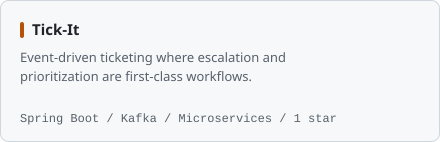
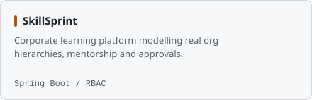
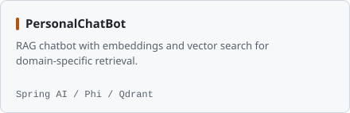
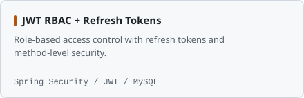
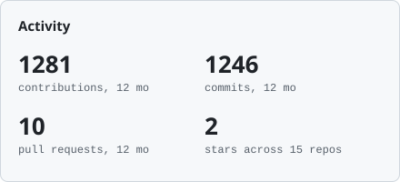
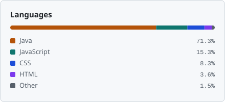

  <picture>
    <source media="(prefers-color-scheme: dark)" srcset="./assets/header-dark.svg" />
    <source media="(prefers-color-scheme: light)" srcset="./assets/header-light.svg" />
    
  </picture>

  <picture>
    <source media="(prefers-color-scheme: dark)" srcset="https://readme-typing-svg.demolab.com?font=JetBrains+Mono&size=16&duration=2800&pause=1400&color=2DD4BF&center=true&vCenter=true&width=640&height=30&lines=consume(microservices).commit();consume(event-streams).commit();consume(rag-pipelines).commit();consume(secure-apis).commit()" />
    <source media="(prefers-color-scheme: light)" srcset="https://readme-typing-svg.demolab.com?font=JetBrains+Mono&size=16&duration=2800&pause=1400&color=0F766E&center=true&vCenter=true&width=640&height=30&lines=consume(microservices).commit();consume(event-streams).commit();consume(rag-pipelines).commit();consume(secure-apis).commit()" />
    
  </picture>

 

## About <code>offset 0</code>

I build the parts of a product nobody notices until they fail: services, queues, auth, and the data paths between them. I work in Java and Spring Boot, reaching for Kafka when services shouldn't wait on each other and Redis when a database shouldn't be asked twice. Lately that work has extended into retrieval, with RAG pipelines over vector search.

Based in Salem, Tamil Nadu. Open to backend and distributed systems roles.

## Now <code>offset 1</code>

- **[Tick-It](https://github.com/HarishSivakumar-dev/Tick-It):** a Kafka-backed microservices platform that makes ticket escalation and prioritization first-class workflows.
- **[Portal Downtime & Latency Analytics](https://github.com/HarishSivakumar-dev/Portal-Downtime-Latency-Analytics-Tool):** a tool for tracking portal downtime and latency, in its early stages.

## Stack <code>offset 2</code>

<picture>
  <source media="(prefers-color-scheme: dark)" srcset="./assets/stack-dark.svg" />
  <source media="(prefers-color-scheme: light)" srcset="./assets/stack-light.svg" />
  
</picture>

## Projects <code>offset 3</code>

<a href="https://github.com/HarishSivakumar-dev/Tick-It"><picture>
  <source media="(prefers-color-scheme: dark)" srcset="https://raw.githubusercontent.com/HarishSivakumar-dev/HarishSivakumar-dev/output/project-Tick-It-dark.svg" />
  <source media="(prefers-color-scheme: light)" srcset="https://raw.githubusercontent.com/HarishSivakumar-dev/HarishSivakumar-dev/output/project-Tick-It-light.svg" />
  
</picture></a>
<a href="https://github.com/HarishSivakumar-dev/SkillSprint"><picture>
  <source media="(prefers-color-scheme: dark)" srcset="https://raw.githubusercontent.com/HarishSivakumar-dev/HarishSivakumar-dev/output/project-SkillSprint-dark.svg" />
  <source media="(prefers-color-scheme: light)" srcset="https://raw.githubusercontent.com/HarishSivakumar-dev/HarishSivakumar-dev/output/project-SkillSprint-light.svg" />
  
</picture></a>
<a href="https://github.com/HarishSivakumar-dev/PersonalChatBot"><picture>
  <source media="(prefers-color-scheme: dark)" srcset="https://raw.githubusercontent.com/HarishSivakumar-dev/HarishSivakumar-dev/output/project-PersonalChatBot-dark.svg" />
  <source media="(prefers-color-scheme: light)" srcset="https://raw.githubusercontent.com/HarishSivakumar-dev/HarishSivakumar-dev/output/project-PersonalChatBot-light.svg" />
  
</picture></a>
<a href="https://github.com/HarishSivakumar-dev/JWT-Based-RBAC-and-Refresh-Tokens"><picture>
  <source media="(prefers-color-scheme: dark)" srcset="https://raw.githubusercontent.com/HarishSivakumar-dev/HarishSivakumar-dev/output/project-JWT-Based-RBAC-and-Refresh-Tokens-dark.svg" />
  <source media="(prefers-color-scheme: light)" srcset="https://raw.githubusercontent.com/HarishSivakumar-dev/HarishSivakumar-dev/output/project-JWT-Based-RBAC-and-Refresh-Tokens-light.svg" />
  
</picture></a>

## Metrics <code>offset 4</code>

<picture>
  <source media="(prefers-color-scheme: dark)" srcset="https://raw.githubusercontent.com/HarishSivakumar-dev/HarishSivakumar-dev/output/stats-dark.svg" />
  <source media="(prefers-color-scheme: light)" srcset="https://raw.githubusercontent.com/HarishSivakumar-dev/HarishSivakumar-dev/output/stats-light.svg" />
  
</picture>
<picture>
  <source media="(prefers-color-scheme: dark)" srcset="https://raw.githubusercontent.com/HarishSivakumar-dev/HarishSivakumar-dev/output/languages-dark.svg" />
  <source media="(prefers-color-scheme: light)" srcset="https://raw.githubusercontent.com/HarishSivakumar-dev/HarishSivakumar-dev/output/languages-light.svg" />
  
</picture>
<picture>
  <source media="(prefers-color-scheme: dark)" srcset="https://raw.githubusercontent.com/HarishSivakumar-dev/HarishSivakumar-dev/output/streak-dark.svg" />
  <source media="(prefers-color-scheme: light)" srcset="https://raw.githubusercontent.com/HarishSivakumar-dev/HarishSivakumar-dev/output/streak-light.svg" />
  
</picture>

## Contribution log <code>offset 5</code>

<picture>
  <source media="(prefers-color-scheme: dark)" srcset="https://raw.githubusercontent.com/HarishSivakumar-dev/HarishSivakumar-dev/output/snake-dark.svg" />
  <source media="(prefers-color-scheme: light)" srcset="https://raw.githubusercontent.com/HarishSivakumar-dev/HarishSivakumar-dev/output/snake-light.svg" />
  
</picture>

## Connect <code>offset 6</code>

[LinkedIn](https://www.linkedin.com/in/harishsivakumar07/) &nbsp;/&nbsp; [Portfolio](https://harish-developer-portfolio-lac.vercel.app) &nbsp;/&nbsp; [GitHub](https://github.com/HarishSivakumar-dev)

 

<picture>
  <source media="(prefers-color-scheme: dark)" srcset="./assets/footer-dark.svg" />
  <source media="(prefers-color-scheme: light)" srcset="./assets/footer-light.svg" />
  
</picture>
